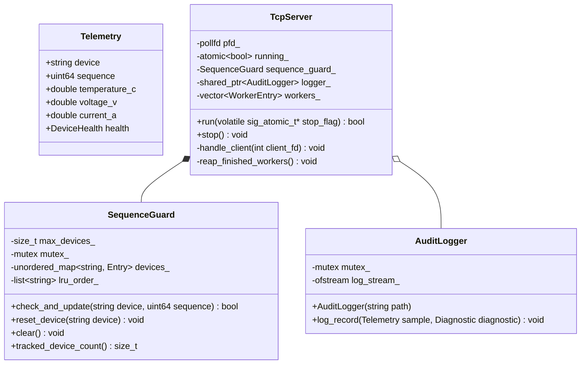
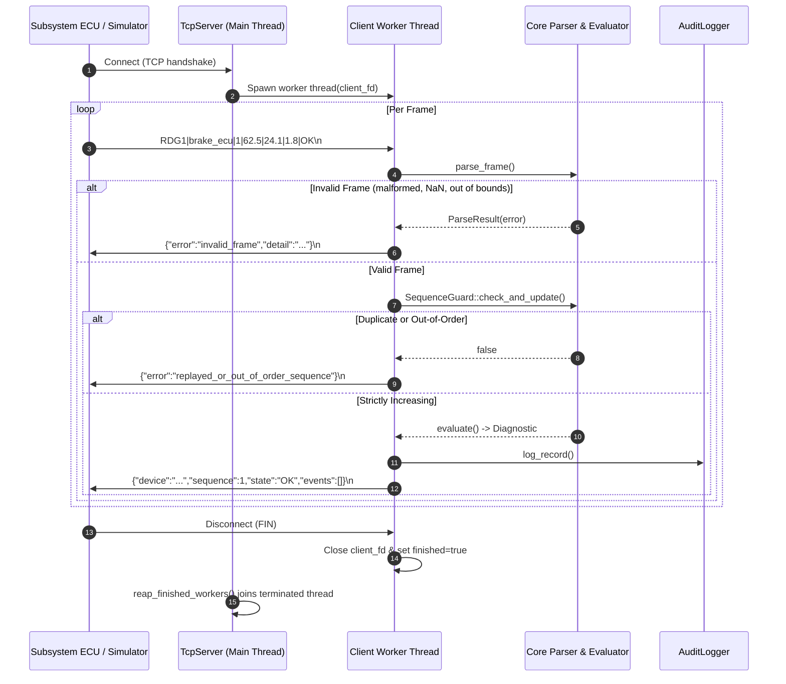
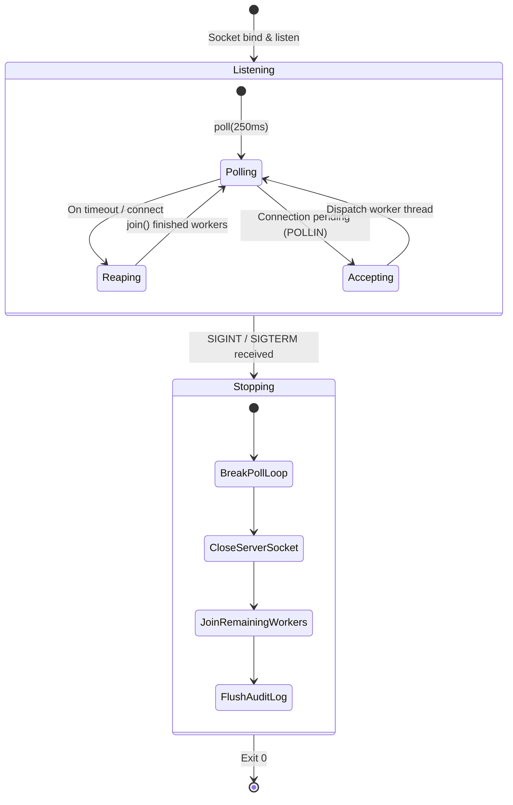

# Software Architecture & Detailed Design

**Document ID:** RDG-SAD-001  
**Version:** 1.0  
**Status:** Baseline Specification  
**Scope:** Onboard Vehicle Diagnostics Gateway Demonstrator  

---

## 1. System Overview

RailDiag Gateway is a C++17 onboard vehicle diagnostics demonstrator. It ingests sensor telemetry from vehicle subsystems (e.g., Brake ECU, Traction Inverter, HVAC controller) over a local TCP simulation transport, verifies protocol invariants and monotonic sequence numbers, classifies health states against diagnostic thresholds, and writes an audit log to disk.

```text
       Subsystem ECUs / Simulator
      (Normal, Warning, Fault, Compound)
                     │
              TCP Port 9100
             ASCII Protocol (RDG1)
                     │
         ┌───────────────────────┐
         │  raildiag-gateway     │
         │───────────────────────│
         │ • Frame Parser        │ ◄── Zero-copy string_view, finite float checks
         │ • Sequence Guard      │ ◄── O(1) LRU capacity cache (max 1024 devices)
         │ • Diagnostic Engine   │ ◄── Multi-event rule evaluation
         │ • Audit Logger        │ ◄── ISO 8601 UTC + steady monotonic µs
         │ • TCP Server          │ ◄── Non-blocking poll() + worker thread reaper
         └───────────────────────┘
                     │
             JSON Diagnostics
                     │
         Test Client / Downstream Bus
```

---

## 2. Component Design



### 2.1 Configuration (`include/raildiag/config.hpp`)
Compile-time constants in `raildiag::config`:
- **Protocol Limits:** `kMaxFrameSize = 512`, `kMaxDeviceIdLength = 48`, `kMaxTrackedDevices = 1024`.
- **Sensor Validation Ranges:** Temperature `[-80.0, 250.0]` °C, Voltage `[0.0, 1000.0]` V, Current `[0.0, 10000.0]` A.
- **Diagnostic Thresholds:** Fault if temperature $\ge 90.0$ °C or voltage $< 18.0$ V; Warning if temperature $\ge 75.0$ °C or voltage $< 21.0$ V.
- **Server:** Listen backlog 16, poll timeout 250 ms, socket receive timeout 1 s.

### 2.2 Telemetry Parsing (`telemetry.hpp` / `telemetry.cpp`)
- Wire protocol uses pipe-delimited ASCII:
  ```text
  RDG1|<device_id>|<sequence>|<temperature_c>|<voltage_v>|<current_a>|<health>\n
  ```
- **Parsing logic:**
  1. Validates field count (exactly 7 tokens) and `RDG1` prefix.
  2. Device ID validated against ASCII `[a-zA-Z0-9_-]` (1 to 48 characters).
  3. Sequence number parsed with `std::from_chars` to reject negative numbers or overflow.
  4. Numeric values validated with `std::stod` and checked against `std::isfinite` to reject `NaN`, `+Inf`, and `-Inf`.
  5. Physical range bounds verified against demonstrator limits.
  6. Health enum parsed (`OK`, `WARN`, `FAULT`).

### 2.3 Diagnostic Rules Engine (`diagnostic.hpp` / `diagnostic.cpp`)
Pure function `evaluate(const Telemetry&)` classifies telemetry:
- Fault events: `DEVICE_REPORTED_FAULT`, `OVERTEMPERATURE` ($\ge 90$ °C), `UNDERVOLTAGE_CRITICAL` ($< 18$ V).
- Warning events: `DEVICE_REPORTED_WARNING`, `OVERTEMPERATURE_WARNING` ($75 \le T < 90$), `UNDERVOLTAGE_WARNING` ($18 \le V < 21$).
- **Multi-event preservation:** Warning conditions are recorded even if another metric faults (e.g. overtemperature fault + undervoltage warning), preserving complete diagnostic context.
- Output JSON format:
  ```json
  {"device":"brake_ecu","sequence":1,"state":"FAULT","events":["OVERTEMPERATURE","UNDERVOLTAGE_WARNING"]}
  ```

### 2.4 Monotonic Sequence Guard (`sequence_guard.hpp` / `sequence_guard.cpp`)
- Thread-safe class backed by a `std::mutex`.
- Enforces strictly increasing sequence numbers per device (`sequence > last_sequence`) to prevent replay attacks.
- Implements an $O(1)$ LRU cache using `std::list<std::string>` and `std::unordered_map` with list iterators. If tracked devices reach `kMaxTrackedDevices` (1,024), the least-recently-seen device is evicted.
- Provides `reset_device()` to allow legitimate resynchronization following an ECU reboot.

### 2.5 Audit Logger (`logger.hpp` / `logger.cpp`)
- Thread-safe CSV logger with dual timestamps:
  1. `timestamp_iso`: Formatted UTC time (`YYYY-MM-DDTHH:MM:SS.sssZ`) for human/system event correlation.
  2. `timestamp_us`: Microseconds from `std::chrono::steady_clock` to guarantee strictly monotonic relative timing immune to NTP wall-clock jumps.
- Column header (`timestamp_iso,timestamp_us,device,sequence,temperature_c,voltage_v,current_a,state`) written automatically when the file is created.
- Timestamp strings are generated before acquiring the mutex lock to minimize critical section contention.

### 2.6 TCP Server & Concurrency (`server.hpp` / `server.cpp`)
- **Non-blocking accept loop:** Uses `poll()` on `server_fd` with a 250 ms timeout. Cleanly breaks when `stop_flag` or `running_` indicates shutdown, avoiding the classic blocking `accept()` hang.
- **Worker thread reclamation:** Client sessions run in detached worker threads tracked by `WorkerEntry`. The accept loop actively reaps finished threads via `reap_finished_workers()`, preventing thread descriptor leaks.
- **Buffer protection:** Inbound buffer capped at 512 bytes. Payloads exceeding this without a newline return `{"error":"frame_too_large"}` and terminate the connection.

---

## 3. Telemetry Processing Flow



---

## 4. Signal Handling & Shutdown Lifecycle



- Signal handler registers `SIGINT` and `SIGTERM`, setting a `volatile sig_atomic_t g_stop_requested = 1`.
- This conforms strictly to POSIX async-signal-safety without calling non-reentrant functions or C++ methods inside the handler.
- The `poll()` loop detects the flag on its 250 ms tick, closes `server_fd`, joins all active workers, flushes the log, and exits with code 0.

---

## 5. PLC Logic Mirror (`plc/VehicleDiagnostic.st`)

An IEC 61131-3 Structured Text program in `plc/` mirrors the gateway diagnostic logic for experimentation with PLC toolchains (e.g. MATIEC):

```pascal
PROGRAM VehicleDiagnostic
VAR
    TemperatureC         : REAL := 20.0;
    VoltageV             : REAL := 24.0;
    DeviceWarning        : BOOL := FALSE;
    DeviceFault          : BOOL := FALSE;
    OverTemperature      : BOOL := FALSE;
    TemperatureWarning   : BOOL := FALSE;
    CriticalUndervoltage : BOOL := FALSE;
    VoltageWarning       : BOOL := FALSE;
    DiagnosticFault      : BOOL := FALSE;
    DiagnosticWarning    : BOOL := FALSE;
END_VAR

OverTemperature := TemperatureC >= 90.0;
CriticalUndervoltage := VoltageV < 18.0;
TemperatureWarning := (TemperatureC >= 75.0) AND (TemperatureC < 90.0);
VoltageWarning := (VoltageV < 21.0) AND (VoltageV >= 18.0);

DiagnosticFault := DeviceFault OR OverTemperature OR CriticalUndervoltage;
DiagnosticWarning := (NOT DiagnosticFault) AND (DeviceWarning OR TemperatureWarning OR VoltageWarning);
END_PROGRAM
```

*Note on physical deployment:* In actual railway software (EN 50128/EN 50716), raw analog inputs require hysteresis (e.g. 2.0 °C deadband) or debounce timers (`TON`/`TOF`) to prevent contact chattering at threshold boundaries.
